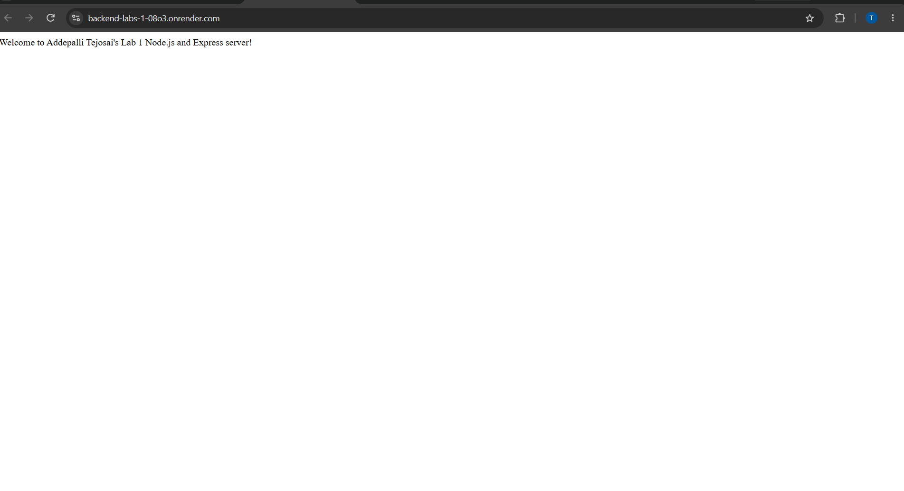
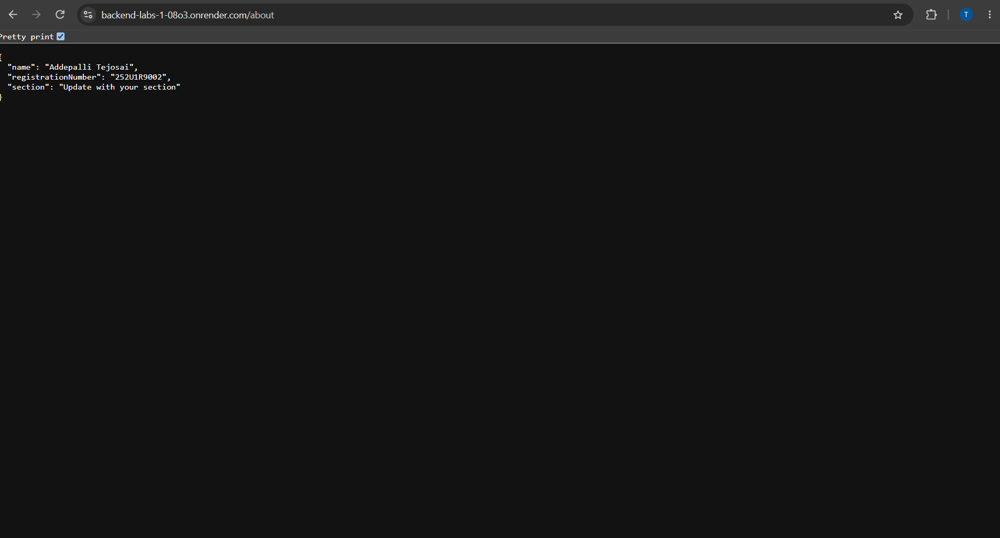
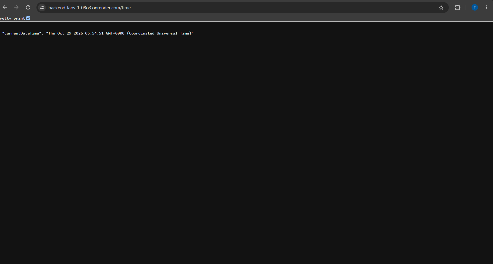
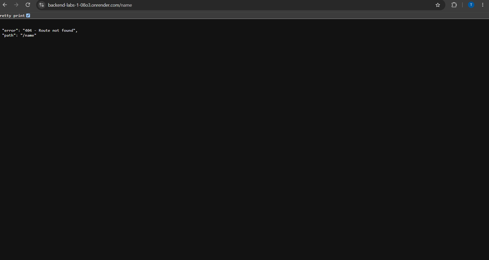

# Lab 1: Node.js and Express server

**Name:** Addepalli Tejosai  
**Registration number:** 252U1R9002  
**Section:** CSE-GAI-2A-304

**Live link:** Not deployed yet. After deployment, paste the public URL here. If you cannot deploy, explain why and include genuine Postman screenshots for each endpoint.

## Objective

Set up a Node.js project and build a small web server first with Node.js's built-in `http` module, then with Express.

## Project files

- `plain-server.js` — simple server using `http.createServer()` that responds with `Hello` on port 3000.
- `server.js` — Express server with `/`, `/about`, `/time`, and a 404 handler.
- `package.json` — project metadata, scripts, and Express dependency.
- `.gitignore` — prevents `node_modules`, `.env`, and debug files from being committed.
- `screenshots/` — contains illustrative preview images. Replace these previews with actual screenshots captured from your browser or Postman before submission.

## Requirements

- Install Node.js and npm.
- Use a terminal in this project folder.
- Do not commit `node_modules/` or `.env`.
- The section is not provided yet; update it above before submitting.

## How to install and run

1. Open a terminal in this folder.
2. Install dependencies:

   ```bash
   npm install
   ```

3. Start the Express server:

   ```bash
   npm start
   ```

4. Open the endpoints below in your browser. The default port is `3000`. If the hosting platform provides a `PORT` environment variable, the app uses it automatically.

To run the plain HTTP server instead, stop the Express server and execute:

```bash
npm run start:http
```

The plain server also uses port `3000`, so do not run both servers at the same time.

## `package.json` fields

- `name`: project/package name.
- `version`: current project version.
- `description`: short explanation of the project.
- `main`: main application file (`server.js`).
- `scripts`: shortcuts for starting the Express and plain HTTP servers.
- `keywords`: searchable labels describing the project.
- `author`: student name.
- `license`: license identifier.
- `dependencies`: packages needed by the project; Express is installed using `npm install`.

`package.json` describes the project and its dependencies. `node_modules/` contains the installed package files. Do not commit `node_modules/`; it can be recreated using `npm install`.

## Endpoints

| Method | Path | Expected status | Description |
|---|---|---:|---|
| GET | `/` | 200 | Returns a welcome message. |
| GET | `/about` | 200 | Returns JSON with name, registration number, and section placeholder. |
| GET | `/time` | 200 | Returns the current server date and time. |
| GET | Any unknown path (example: `/unknown`) | 404 | Returns a JSON error message and the requested path. |

## Screenshots

The files currently in `screenshots/` are **illustrative previews, not genuine browser captures**. Run the server and replace them with actual screenshots of the working endpoints before submitting.

- `home-preview.png` — preview for `GET /`
- `about-preview.png` — preview for `GET /about`
- `time-preview.png` — preview for `GET /time`
- `not-found-preview.png` — preview for the 404 handler

Markdown image example:

```markdown




```

## Viva preparation

**1. What is the difference between `package.json` and `node_modules`?**  
`package.json` stores project information and lists dependencies. `node_modules` contains the installed package code.

**2. What does `app.listen()` do?**  
It starts the Express application listening for incoming requests on the specified port.

**3. What do request and response represent?**  
The request (`req`) contains information sent by the client, such as the URL and HTTP method. The response (`res`) is used by the server to send a status code and content back to the client.

## Notes: problems faced and how they were solved

Complete this section after running the project. Mention any actual errors you encountered and how you fixed them. Do not claim issues that you did not experience.

## Before submission checklist

- [ ] Update the section.
- [ ] Run `npm install` and `npm start`.
- [ ] Open `/`, `/about`, `/time`, and `/unknown`; confirm status codes `200`, `200`, `200`, and `404`.
- [ ] Replace the illustrative previews with genuine browser/Postman screenshots.
- [ ] Deploy the server and add the public URL, or explain why deployment was not possible and include Postman screenshots.
- [ ] Commit the `lab-01/` folder to the course GitHub repository and share the repository with faculty.
