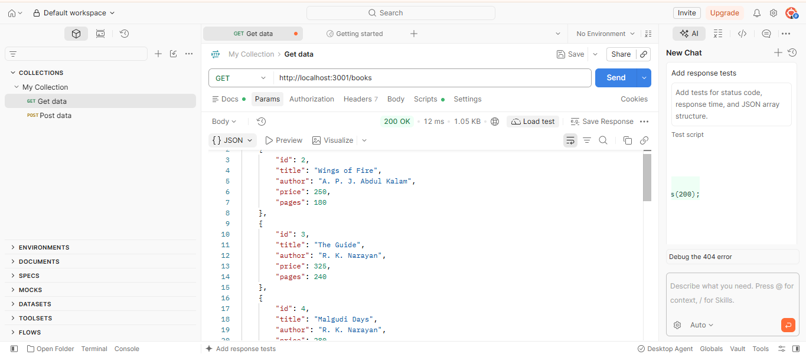
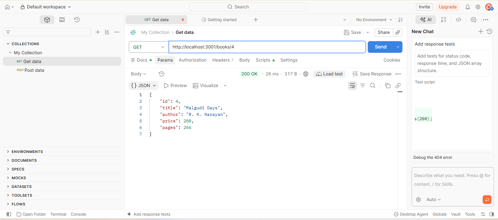
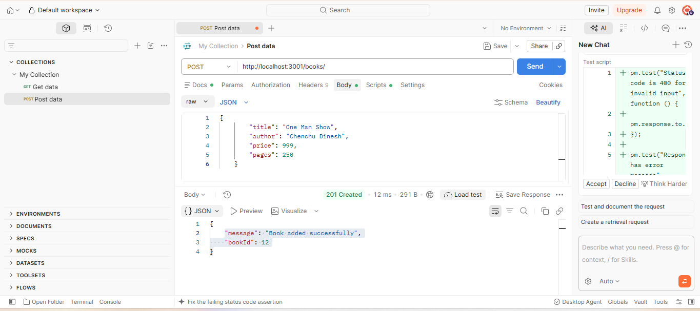
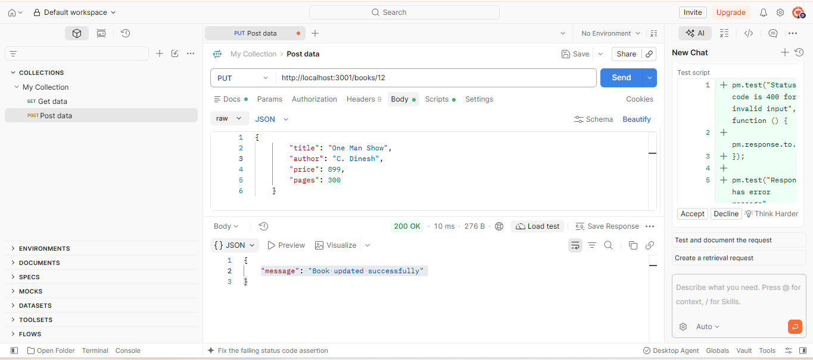
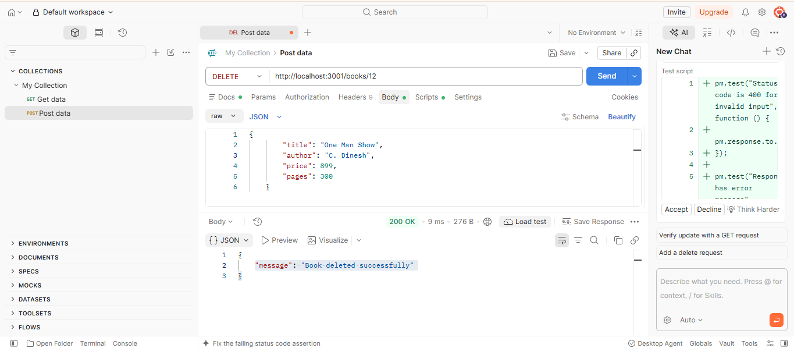
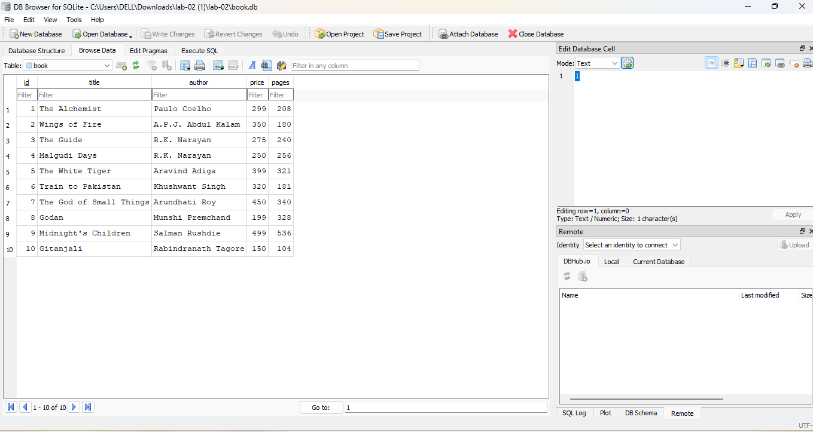

# Lab 2: SQLite database and CRUD routes

**Name:** Addepalli Tejosai
**Registration number:** 252U1R9002 
**Section:**  CSE-GENAI-2A(304)

**Live link:**  https://backend-labs-2-k49j.onrender.com

## How to run

```bash
# 1. Install dependencies
npm install

# 2. (Optional) set environment variables – copy the example and edit
cp .env.example .env      # PORT defaults to 3000; no real secrets are needed

# 3. Start with auto-restart (nodemon)
npm run dev
# or plain node
npm start
```

**Environment variables:** `PORT` (optional, default `3000`).

### Recreate the database (optional)

`book.db` is included. To rebuild it from scratch with the SQLite CLI:

```bash
rm book.db
sqlite3 book.db < book.sql
```

Table: `book(id INTEGER PRIMARY KEY, title TEXT, author TEXT, price INTEGER, pages INTEGER)` with 10 sample rows.

## Endpoints

| Method | Path | Description |
| --- | --- | --- |
| GET | `/books/` | Return all books |
| GET | `/books/:bookId/` | Return one book by id (404 if missing) |
| POST | `/books/` | Add a new book (201 on success) |
| PUT | `/books/:bookId/` | Update an existing book (404 if missing) |
| DELETE | `/books/:bookId/` | Delete a book (404 if missing) |

Request body for POST / PUT:

```json
{ "title": "Book title", "author": "Author name", "price": 500, "pages": 300 }
```

Status codes: `200` OK, `201` created, `400` invalid input, `404` not found, `500` server error.

## Screenshots








